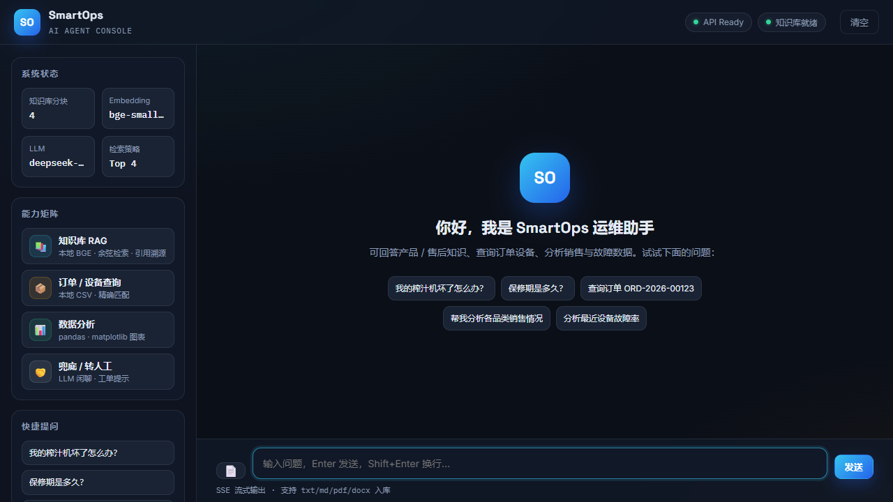
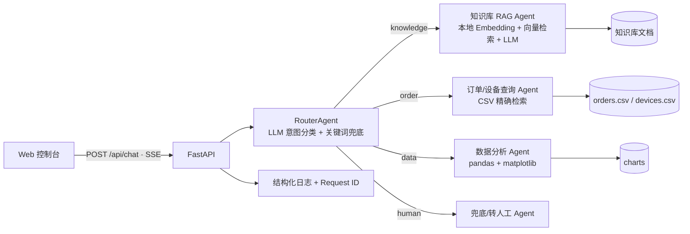

# SmartOps-AI-Agent 🛠️

> **面向电商 / 物联网售后场景的多 Agent 智能客服与数据分析系统**  
> FastAPI + LangChain + 本地 RAG + SSE 分片输出 + Web 控制台

将产品售后知识、订单查询和经营报表整合到一个聊天入口：Router 识别意图，调度知识库、订单/设备、数据分析、接待四个处理模块，返回答案、引用或图表。

**技术栈：** Python · FastAPI · LangChain · BGE/FastEmbed · NumPy · pandas · matplotlib · SSE · Docker

### 重点实现

- **路由与降级：** 明确转人工优先；数据分析关键词走快速通道；其他问题使用 LLM 分类，失败时回退规则。
- **有依据的回答：** 本地向量检索 + 最低相似度过滤；无有效资料时直接拒答并跳过生成调用；返回原始来源和片段。
- **可追踪执行：** SSE 返回路由结果、请求 ID、处理结果类型和路由/Agent 耗时；控制台展示总耗时，可用请求 ID 对照日志。
- **可复现验证：** 离线 pytest、Ruff 和 CI；覆盖转人工优先级、检索阈值、拒答、SSE 异常与引用链路。

---

## ✨ 核心亮点

| 能力 | 说明 |
|---|---|
| 🧠 多 Agent 架构 | 4 个子 Agent：知识库 RAG / 订单设备查询 / 数据分析 / 兜底转人工，由 Router 统一调度 |
| 📚 本地化 RAG | `BAAI/bge-small-zh-v1.5` 本地向量化 + NumPy 向量库，零外部 Embedding 依赖，支持引用溯源 |
| 📊 数据分析 | pandas 统计 + matplotlib 图表，覆盖销售品类、月度趋势、设备故障码分布 |
| ⚡ SSE 分片输出 | FastAPI `StreamingResponse` + 前端打字机，`meta → sources（可选）→ delta → chart（可选）→ done` 事件协议 |
| 🔐 工程化细节 | 请求 ID 中间件、结构化日志、上传大小限制、文件类型白名单、CORS 可配置 |
| 🧪 质量保障 | pytest 接口层 + 单元测试、Ruff 静态检查、GitHub Actions CI |
| 🐳 部署友好 | Docker Compose 一键启动，空 volume 自动生成种子数据与向量索引 |



---

## 🏗️ 整体架构



### 请求链路

```text
用户提问（Web 前端，打字机流式输出）
        │  fetch / POST /api/chat  (SSE text/event-stream)
        ▼
[ FastAPI 后端 ]   ← 请求 ID / 日志 / CORS / 异常兜底
        │
        ▼
[ RouterAgent ]  ← LLM 意图分类 + 关键词规则降级
        ├── 1️⃣ knowledge   → 业务知识库 Agent（RAG：BGE 本地向量化 + 余弦检索 + LLM 生成）
        ├── 2️⃣ order       → 订单 / 设备状态查询 Agent（本地 CSV 检索，模拟外部 API）
        ├── 3️⃣ data        → 数据分析 Agent（pandas 统计 + matplotlib 图表）
        └── 4️⃣ human       → 兜底 / 转人工 Agent（闲聊、强情绪转人工）
```

---

## 🚀 快速开始

```bash
# 1. 创建虚拟环境并安装依赖
python -m venv .venv
# Windows: .venv\Scripts\activate

# 2. 配置 LLM 网关（复制 .env.example 为 .env，填入你的 API Key）
cp .env.example .env

# 3. 安装依赖
pip install -r requirements.txt

# 4. 安装开发依赖（可选，用于测试和 lint）
pip install -r requirements-dev.txt

# 5. 生成示例数据（订单 CSV + 设备故障 CSV + 知识库文档）并完成 RAG 入库
python scripts/seed_data.py

# 6. 启动服务（浏览器访问 http://127.0.0.1:8000）
uvicorn app.main:app --reload --port 8000
```

> 国内网络首次运行会自动使用 HF 镜像（hf-mirror.com）下载约 100MB 的 BGE 模型，如已有 `deepseek-rag-qa/data/models` 缓存会自动复用，跳过下载。

## 🐳 Docker 部署

```bash
# 1. 准备好 .env（从 .env.example 复制并填入 API Key）
cp .env.example .env

# 2. 构建并后台启动
docker compose up --build -d

# 3. 打开 http://127.0.0.1:8000
```

首次启动时，容器入口脚本会自动探测示例数据与向量索引；若为空 volume 会自动执行 `scripts/seed_data.py` 完成数据生成和 RAG 入库。

---

## 💬 试一下

打开 `http://127.0.0.1:8000`，输入：

| 输入 | 命中的 Agent | 演示效果 |
|---|---|---|
| 我的榨汁机坏了怎么办？ | 📚 知识库 Agent | 依据说明书 RAG 回答 + 引用来源 |
| 保修期是多久？ | 📚 知识库 Agent | 售后政策检索 |
| 查询订单 ORD-2026-00123 | 📦 订单查询 Agent | 返回订单详情 |
| 帮我分析各品类销售情况 | 📊 数据分析 Agent | 品类柱状图 |
| 分析最近设备故障率 | 📊 数据分析 Agent | 故障码分布饼图 + 月度趋势 |
| 我要转人工投诉 | 🤝 兜底 Agent | 转人工提示 |

---

## 🔌 核心接口

### `POST /api/chat` — SSE 流式对话

请求：

```json
{ "message": "帮我分析各品类销售情况", "conversation_id": "可选" }
```

事件协议：

| 事件 | 说明 |
|---|---|
| `meta` | 路由意图 + `conversation_id` + `request_id` |
| `delta` | 文本分片，前端打字机 |
| `chart` | 图表 URL（数据分析 Agent） |
| `sources` | 知识库引用列表 |
| `done` | 流结束；成功时附 `result_type` 与 `timings_ms`（routing / agent / total，单位毫秒） |
| `error` | 服务异常信息 |

### 其他接口

- `POST /api/ingest` — 上传文档入库（txt/md/pdf/docx，默认 ≤20MB）
- `GET /api/health` — 健康检查（服务名 / 版本 / 环境）
- `GET /api/stats` — 知识库统计（分块数 / Embedding / LLM / Top-K）

---

## 🧪 测试与代码质量

```bash
pip install -r requirements-dev.txt
ruff check app tests scripts
python -m pytest -q
```

测试覆盖：

- 意图路由关键词兜底（LLM 故障时保证路由不中断）
- 订单 / 设备 CSV 查询
- NumPy 向量库增删查 / 持久化
- 文本切分器
- FastAPI 接口层：健康检查、SSE 流式协议、上传文件校验
- RAG：阈值边界、过滤低相关片段、无命中不调用 LLM
- 转人工优先级、端到端 handoff、SSE 请求追踪与异常脱敏

GitHub Actions 会在每次 push / PR 自动执行 lint + tests。

---

## 🧩 项目结构

```text
SmartOps-AI-Agent/
├── app/
│   ├── main.py            # FastAPI 入口 + SSE + 请求 ID 中间件
│   ├── config.py          # 集中式配置（环境变量驱动）
│   ├── logging.py         # 统一日志配置
│   ├── dispatcher.py      # Agent 调度器
│   ├── knowledge.py       # RAG 管线
│   ├── embeddings.py      # 本地 BGE Embedding
│   ├── vectorstore.py     # NumPy 向量库
│   ├── chunker.py         # 文本切分
│   ├── loader.py          # 文档加载
│   └── agents/            # Router + 4 个子 Agent
├── web/
│   ├── index.html         # 聊天控制台页面
│   ├── styles.css         # 控制台样式
│   └── app.js             # SSE 流式 / 上传 / 状态面板逻辑
├── scripts/
│   ├── seed_data.py       # 示例数据生成 + 入库
│   └── docker_entrypoint.sh # Docker 首次启动自动初始化
├── tests/                 # pytest 单元 + 接口测试
├── docs/
│   └── screenshot.png     # 控制台界面截图
├── pyproject.toml         # ruff / pytest 配置
├── Dockerfile
├── docker-compose.yml
└── data/                  # CSV / 向量索引 / 图表 / 模型缓存（生成物）
```

---

## 技术设计与取舍

- **按业务能力拆分处理模块：** 路由层负责意图分发，各模块分别处理知识、查询、报表和接待，便于独立测试与替换数据源。
- **限制知识回答依据：** BGE 向量化后执行余弦检索，通过 `SCORE_THRESHOLD` 过滤低相关片段；无命中时直接拒答。
- **隔离外部服务故障：** 分类失败时回退规则；订单和报表处理无需 LLM。知识问答在有检索结果时仍依赖生成服务，失败会返回可追踪的错误事件。
- **SSE 输出方式：** Agent 完成回答后，通过 `StreamingResponse` 将文本分片发送；前端用 `fetch ReadableStream` 渲染。当前并未接入模型 token 流，首字等待仍包含完整生成耗时。
- **工程验证：** 请求 ID 与结构化日志、上传大小/类型校验、CORS 配置化、接口测试、Ruff、CI 和 Docker 部署配置。

---

## 实现边界

当前是 **Router + 专项处理模块的工作流**，一次请求只选一个模块，不含自主规划、多轮工具循环或 Agent 间协商。订单/设备使用种子 CSV；数据分析使用固定报表逻辑；转人工仅为提示，没有真实工单集成。`conversation_id` 用于关联请求，未实现服务端多轮记忆。

`SCORE_THRESHOLD=0.35` 是可调默认值，需结合知识库验证；检索相似度不代表答案准确率。

---

## 🔄 替换为自己的 LLM

本项目使用 **OpenAI 兼容接口**，只需修改 `.env` 中的 `LLM_BASE_URL` / `LLM_API_KEY` / `LLM_MODEL`，即可无缝切换到 DeepSeek、通义、智谱、或企业内部网关，**不需要改任何代码**。

---

*面向电商客服与物联网售后场景的 AI 服务。*
